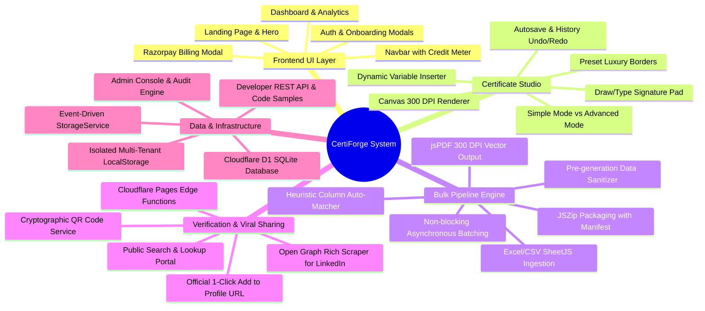
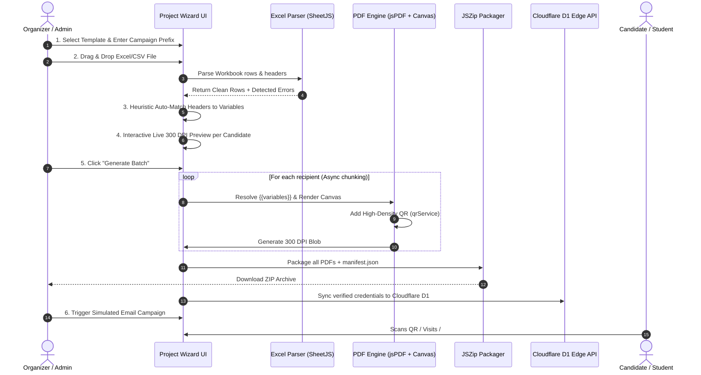
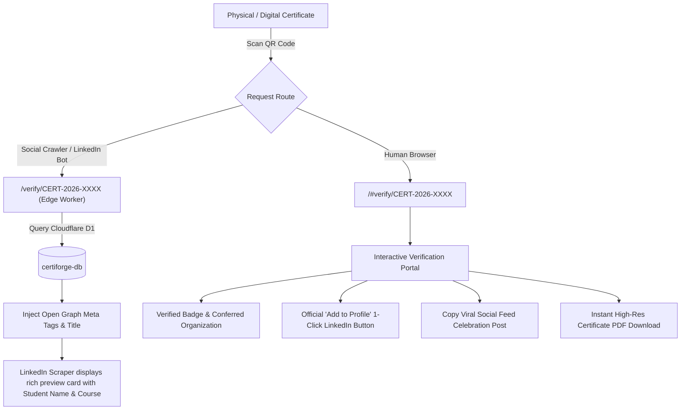
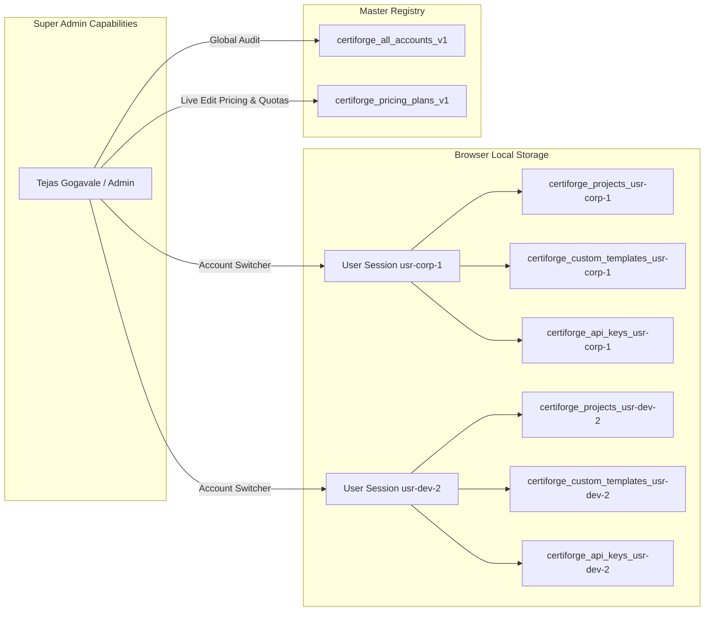

# CertiForge (CertifyPro) — Complete Project Mind Map & Architecture Blueprint

> **System Status:** Production Ready • **Engine:** React 19 + TypeScript + Vite + Cloudflare D1  
> **Repository:** `certifypro` (CertiForge SaaS Platform)  
> **Document Purpose:** Single Source of Truth (SSOT), Mind Map, Component Directory, Data Contracts, User Personas, and Master Contacts.

---

## 📑 Table of Contents

1. [Executive Summary & Core Philosophy](#1-executive-summary--core-philosophy)
2. [Visual System Mind Maps](#2-visual-system-mind-maps)
   - [2.1 High-Level Architecture Mind Map](#21-high-level-architecture-mind-map)
   - [2.2 Bulk Generation & Ingestion Pipeline](#22-bulk-generation--ingestion-pipeline)
   - [2.3 Verification & LinkedIn Credential Protocol](#23-verification--linkedin-credential-protocol)
   - [2.4 Multi-Tenant Workspace & Security Isolation](#24-multi-tenant-workspace--security-isolation)
3. [Technology Stack & Runtime Environment](#3-technology-stack--runtime-environment)
4. [Master Contacts, Personas & System Credentials](#4-master-contacts-personas--system-credentials)
   - [4.1 Administrative & Platform Owner Contacts](#41-administrative--platform-owner-contacts)
   - [4.2 Pre-Configured Demo Accounts & Roles](#42-pre-configured-demo-accounts--roles)
   - [4.3 Service Endpoints & Support Contacts](#43-service-endpoints--support-contacts)
5. [Complete Repository & File Structure Directory](#5-complete-repository--file-structure-directory)
6. [Data Models & TypeScript Type Definitions](#6-data-models--typescript-type-definitions)
7. [Cloudflare D1 Database Schema (`schema.sql`)](#7-cloudflare-d1-database-schema-schemasql)
8. [Certificate Specification & Field Taxonomy](#8-certificate-specification--field-taxonomy)
   - [8.1 Core Certificate Elements (11 Fields)](#81-core-certificate-elements-11-fields)
   - [8.2 Optional Student & Course Metadata (13 Fields)](#82-optional-student--course-metadata-13-fields)
   - [8.3 Signatory Authority Hierarchy (5 Roles)](#83-signatory-authority-hierarchy-5-roles)
   - [8.4 Heuristic Column Matching Matrix](#84-heuristic-column-matching-matrix)
9. [Subsystem Deep Dives](#9-subsystem-deep-dives)
   - [9.1 Drag-and-Drop Certificate Studio (`CertificateDesigner.tsx`)](#91-drag-and-drop-certificate-studio-certificatedesignertsx)
   - [9.2 6-Step Project Wizard & Bulk Generation Engine (`ProjectWizard.tsx`)](#92-6-step-project-wizard--bulk-generation-engine-projectwizardtsx)
   - [9.3 PDF Generation Engine & Vector Rendering (`pdfGenerator.ts`)](#93-pdf-generation-engine--vector-rendering-pdfgeneratorts)
   - [9.4 Cryptographic QR Verification & Edge Crawler Engine](#94-cryptographic-qr-verification--edge-crawler-engine)
   - [9.5 LinkedIn 1-Click Credential & Viral Sharing Service](#95-linkedin-1-click-credential--viral-sharing-service)
   - [9.6 Email Delivery Campaign Simulator (`EmailCampaignModal.tsx`)](#96-email-delivery-campaign-simulator-emailcampaignmodaltsx)
   - [9.7 SaaS Monetization, Quota Enforcement & Razorpay Simulation](#97-saas-monetization-quota-enforcement--razorpay-simulation)
   - [9.8 Super Admin Console & Dynamic Pricing Configurator (`AdminView.tsx`)](#98-super-admin-console--dynamic-pricing-configurator-adminviewtsx)
   - [9.9 Developer REST API & Playground (`ApiPlayground.tsx`)](#99-developer-rest-api--playground-apiplaygroundtsx)
10. [State Management & Multi-Tenant Storage Service (`storageService.ts`)](#10-state-management--multi-tenant-storage-service-storageservicets)
11. [Edge API Contracts & Cloudflare Workers Functions](#11-edge-api-contracts--cloudflare-workers-functions)
12. [Verification Matrix & Operations Guide](#12-verification-matrix--operations-guide)

---

## 1. Executive Summary & Core Philosophy

**CertiForge** (codebase `certifypro`) is an enterprise-grade, high-performance SaaS web application engineered to solve end-to-end credential management for academic institutions, universities, corporate bootcamps, and event organizers.

### The Problem It Solves
Traditional certificate generation is manual, brittle, and unverified: designing certificates in Canva or Illustrator, manually typing names, emailing individual attachments, and suffering from fake, unverified paper credentials.

### The Solution: "Design Once, Upload Recipient Data, Generate Thousands in Minutes"
- **Luxury Studio:** Precision vector certificate designer supporting landscape/portrait, double gold foil borders, guilloche patterns, dynamic typography, and live signature capture.
- **Intelligent Ingestion:** Spreadsheet parser (`.xlsx`, `.xls`, `.csv`) that automatically matches headers (`Student Name` ➔ `{{name}}`) and validates rows.
- **Non-blocking Batch Engine:** Browser-side vector 300 DPI rendering generating thousands of individual PDFs bundled into ZIP archives with JSON manifests.
- **Permanent Cryptographic Proof:** Every certificate carries a unique tamper-proof ID and high-density QR code verifiable via edge Cloudflare D1 routes with Open Graph support for viral LinkedIn crawlers.

---

## 2. Visual System Mind Maps

### 2.1 High-Level Architecture Mind Map

```
                                    CertiForge (CertifyPro) SaaS
                                                  │
         ┌───────────────────┬────────────────────┼────────────────────┬───────────────────┐
         ▼                   ▼                    ▼                    ▼                   ▼
    [Presentation]       [Design Studio]     [Bulk Pipeline]      [Verification]      [Platform/Admin]
    • Landing Page       • Simple Mode       • Excel/CSV Ingest   • Public QR Portal  • User Management
    • SaaS Navbar        • Advanced Mode     • Column Matcher     • Edge D1 Lookup    • Dynamic Pricing
    • Dashboard & Stats  • Canvas 300 DPI    • Batch PDF Render   • Open Graph Bot    • Multi-Tenant Storage
    • Billing (Razorpay) • Undo/Redo Engine  • ZIP Archiver       • 1-Click LinkedIn  • Analytics Views
    • Auth & Onboarding  • Signatures/Seals  • Email Simulator    • Viral Sharing     • Developer REST API
```



### 2.2 Bulk Generation & Ingestion Pipeline



### 2.3 Verification & LinkedIn Credential Protocol



### 2.4 Multi-Tenant Workspace & Security Isolation



---

## 3. Technology Stack & Runtime Environment

| Category | Technology | Version | Purpose & Description |
| :--- | :--- | :--- | :--- |
| **Core Framework** | React | `^19.2.8` | Declarative UI, Concurrent rendering, hooks |
| **DOM Engine** | React-DOM | `^19.2.8` | DOM rendering & portals |
| **Language** | TypeScript | `~6.0.2` | Static typing, interface contracts |
| **Bundler & Dev** | Vite | `^8.3.0` | Ultra-fast HMR and ESM production bundling |
| **Styling** | TailwindCSS | `^3.4.19` | Utility-first responsive CSS styling |
| **Post-Processing** | PostCSS + Autoprefixer | `^8.5.29` / `^10.6.1` | Cross-browser vendor prefixing |
| **Linter** | Oxlint | `^1.81.0` | High-speed Rust-based JavaScript/TypeScript linter |
| **PDF Generation** | jsPDF | `^4.2.1` | Vector-accurate client-side PDF document generation |
| **Spreadsheet Ingest**| xlsx (SheetJS) | `^0.18.5` | In-browser parsing of `.xlsx`, `.xls`, and `.csv` files |
| **Archive Bundler** | JSZip | `^3.10.2` | Client-side compression of bulk PDFs with Deflate algorithm |
| **QR Engine** | qrcode | `^1.5.4` | High-density vector/canvas QR code generator |
| **Micro-Animations** | canvas-confetti | `^1.9.4` | Celebration confetti upon batch generation & verification |
| **Iconography** | Lucide React | `^1.53.0` | Modern, clean vector iconography |
| **Serverless Edge** | Cloudflare Pages Functions | Node / V8 | Edge API routes for Auth, Sync, and SSR Open Graph |
| **Database** | Cloudflare D1 | SQLite Edge | Global distributed serverless SQL database (`certiforge-db`) |

---

## 4. Master Contacts, Personas & System Credentials

### 4.1 Administrative & Platform Owner Contacts

These contacts hold platform-wide authority, bypass restrictions, and manage global SaaS pricing and quotas:

| Contact / Name | Email Address | Role | Associated Organization | Quotas & Plan | Master Passwords Accepted |
| :--- | :--- | :--- | :--- | :--- | :--- |
| **Tejas Gogavale** *(Platform Owner)* | `tejasgogavale5@gmail.com` | `admin` | CertiForge Global Platform | 25,000 Certs / 100 GB / Business | `admin`, `admin123`, `123456` |
| **Platform Administrator** *(System Admin)* | `admin@certiforge.io` | `admin` | CertiForge Global Authority | 25,000 Certs / 100 GB / Business | `admin`, `admin123`, `123456` |
| **Master Admin Fallback** | `admin@certiforge.com` | `admin` | CertiForge Root | 25,000 Certs / 100 GB / Business | `admin`, `admin123`, `123456` |

> **Admin Email Rule:** In `storageService.ts` and `functions/api/auth.ts`, any email address containing `admin` or starting with `admin@` is automatically granted `role: 'admin'` and `plan: 'business'`.

---

### 4.2 Pre-Configured Demo Accounts & Roles

Used for multi-tenant verification, account switching, and demonstration:

| Persona | Email | Organization | Plan | Scoped Workspace ID | Description |
| :--- | :--- | :--- | :--- | :--- | :--- |
| **Dr. Arthur Sterling** | `arthur.s@institute.edu` | Global Leadership Institute | `pro` | `usr-corp-1` | Executive corporate certs, 3,000 certs limit, 15 GB storage. |
| **Aarav Patel** | `aarav@devstudio.com` | DevStudio Academy | `starter` | `usr-dev-2` | Coding bootcamp certificates, 500 certs limit, 1 GB storage. |
| **Smit Panchal** | `smit@devstudio.com` | DevStudio Academy | Recipient | `rec-dev-1` | Sample verified bootcamp graduate (`DEV-2026-0001`). |
| **Ananya Sharma** | `ananya.sharma@example.com` | Global Leadership Institute | Recipient | Sample Recipient | Digital Marketing Masterclass distinction graduate (`CERT-2026-00001`). |

---

### 4.3 Service Endpoints & Support Contacts

| Service Domain / Channel | Location / Value | Description |
| :--- | :--- | :--- |
| **Customer Support Email** | `support@certiforge.io` | Primary helpdesk mentioned in SaaS footer |
| **Automated Delivery Email** | `certificates@institution.edu` | Configurable simulation sender for bulk certificate delivery |
| **Production Cloudflare Domain** | `https://certiforge.pages.dev` | Live Pages deployment URL |
| **Primary Domain** | `https://certiforge.io` | Branded SaaS custom domain |
| **Server Hosting Region** | Mumbai (`ap-south-1`) | Cloudflare edge presence with sub-10ms response time |
| **Cloudflare D1 Database Name** | `certiforge-db` | SQLite D1 binding `DB` |
| **Cloudflare D1 Database ID** | `1c138ec4-52d0-43a9-a402-25baaf34efc4` | Production D1 unique identifier in `wrangler.toml` |

---

## 5. Complete Repository & File Structure Directory

```
certifypro/
├── .oxlintrc.json                      # Oxlint linter rules
├── .wrangler/                          # Wrangler local emulation state
├── index.html                          # Single Page App shell (luxury typography fonts loaded)
├── package.json                        # Dependencies, dev scripts & metadata
├── postcss.config.js                   # TailwindCSS & Autoprefixer plugin config
├── README.md                           # Project feature showcase & run commands
├── schema.sql                          # Cloudflare D1 schema (users, projects, certificates, api_keys)
├── tailwind.config.js                  # Tailwind utility classes & theme extensions
├── tsconfig.json                       # Base TypeScript configuration
├── tsconfig.app.json                   # App-specific TS compiler settings
├── tsconfig.node.json                  # Node/Vite TS compiler settings
├── vite.config.ts                      # Vite build configuration with React plugin
├── wrangler.toml                       # Cloudflare Pages & D1 database binding config
│
├── functions/                          # Cloudflare Pages Functions (Edge Serverless API)
│   ├── api/
│   │   ├── auth.ts                     # Login, signup, password hashing & admin auto-provisioning
│   │   ├── certificates.ts             # Batch sync generated certificates to Cloudflare D1
│   │   └── verify/
│   │       └── [id].ts                 # JSON verification lookup endpoint for certificates
│   └── verify/
│       └── [id].ts                     # SSR HTML route with Open Graph meta tags for LinkedIn crawler
│
├── public/                             # Static public assets
│
└── src/                                # React Frontend Source Tree
    ├── App.css                         # App-level styling overrides
    ├── App.tsx                         # Core router, modal coordination & application state
    ├── index.css                       # Global styles, font definitions & Tailwind directives
    ├── main.tsx                        # React 19 root bootstrap (`createRoot`)
    │
    ├── assets/                         # Graphic assets & logos
    │
    ├── types/
    │   └── index.ts                    # Master TypeScript definitions (Project, Recipient, Template, etc.)
    │
    ├── data/
    │   ├── certificateFields.ts        # Specification for 11 core + 13 optional fields + 5 signatories
    │   ├── defaultTemplates.ts         # 4 Built-in luxury templates + 4 SaaS pricing plans
    │   └── sampleData.ts               # Sample recipients, mock student data & demo projects
    │
    ├── services/
    │   ├── excelParser.ts              # SheetJS parsing, row validation & heuristic header matcher
    │   ├── linkedinService.ts          # Official LinkedIn 'Add to Profile' protocol & viral post builder
    │   ├── pdfGenerator.ts             # jsPDF 300 DPI vector engine, canvas rendering & batcher
    │   ├── qrService.ts                # High-density QR code data URL generator
    │   ├── storageService.ts           # Multi-tenant LocalStorage, account switching & API sync
    │   └── zipPackager.ts              # JSZip bundler with JSON manifest generator & blob downloader
    │
    └── components/
        ├── Navbar.tsx                  # SaaS sticky navigation bar, quota badges & account switcher
        ├── Footer.tsx                  # SaaS footer with trust seals, status, and legal links
        │
        ├── LandingPage/
        │   └── LandingPage.tsx         # Hero section, feature matrices, interactive FAQs, and pricing
        │
        ├── Dashboard/
        │   └── DashboardView.tsx       # KPI metrics, storage gauges, recent campaigns & action buttons
        │
        ├── Designer/
        │   ├── CertificateDesigner.tsx # Drag-and-drop studio, layer ordering, coordinate positioning
        │   ├── SaveTemplateModal.tsx   # Modal for saving custom designs to workspace library
        │   └── SignaturePadModal.tsx   # Interactive signature drawer (Canvas draw, typed cursive, upload)
        │
        ├── ProjectWizard/
        │   ├── NewProjectModal.tsx     # Fast project creator modal
        │   └── ProjectWizard.tsx       # 6-step bulk creation pipeline (Upload, Match, Preview, Gen, Export)
        │
        ├── Templates/
        │   └── TemplateLibrary.tsx     # Card grid of templates, category tabs, orientation toggles
        │
        ├── Verification/
        │   ├── VerificationPortal.tsx  # Public credential search portal, trust badges & action bars
        │   ├── LinkedInShareModal.tsx  # Modal displaying viral post copy & feed share triggers
        │   └── LinkedInEditorModal.tsx # Modal allowing live editing of LinkedIn certification metadata
        │
        ├── EmailDelivery/
        │   └── EmailCampaignModal.tsx  # Dynamic email body template & delivery tracking simulator
        │
        ├── Billing/
        │   └── BillingModal.tsx        # Tiered plan picker & Razorpay sandbox checkout simulation
        │
        ├── Analytics/
        │   └── AnalyticsView.tsx       # Monthly issuance bar charts, conversion counters & metrics
        │
        ├── Settings/
        │   └── SettingsView.tsx        # Organization branding, custom domain, white-label, team seats
        │
        ├── Api/
        │   └── ApiPlayground.tsx       # API key generator and code snippets in cURL, Node.js, and Python
        │
        ├── Auth/
        │   ├── AuthModal.tsx           # Login, Sign Up, and Forgot Password dialog
        │   └── OnboardingModal.tsx     # New user workspace domain & first-action onboarding flow
        │
        └── Admin/
            └── AdminView.tsx           # Global platform user registry, role manager, dynamic pricing editor
```

---

## 6. Data Models & TypeScript Type Definitions

From [`src/types/index.ts`](file:///c:/Users/hp/JC-Panchal%20-3d8d/air%20power%20images/certifypro/src/types/index.ts):

### Key Interfaces

```typescript
// 1. Certificate Element Type
export type ElementType = 
  | 'text' | 'dynamic_field' | 'image' | 'logo' 
  | 'signature' | 'shape' | 'line' | 'qr' 
  | 'certificate_id' | 'seal';

// 2. Fine-grain Font & Coordinate Settings
export interface FontSettings {
  family: string;
  size: number;
  weight: '300' | '400' | '500' | '600' | '700' | '800';
  color: string;
  align: 'left' | 'center' | 'right';
  letterSpacing: number; // in px
  lineHeight: number; // ratio e.g. 1.2
  fontStyle?: 'normal' | 'italic';
  textTransform?: 'none' | 'uppercase' | 'capitalize';
}

export interface TemplateElement {
  id: string;
  type: ElementType;
  x: number; // percentage (0-100)
  y: number; // percentage (0-100)
  width: number;
  height: number;
  rotation?: number;
  zIndex: number;
  isLocked?: boolean;
  content: string; // text or image URL
  fieldKey?: string; // e.g. 'name', 'course', 'date'
  fontSettings?: FontSettings;
  opacity?: number;
  borderRadius?: number;
  backgroundColor?: string;
  borderColor?: string;
  borderWidth?: number;
  shapeType?: 'rectangle' | 'circle' | 'badge' | 'line';
}

// 3. Complete Template Structure
export interface Template {
  id: string;
  name: string;
  description: string;
  category: TemplateCategory;
  orientation: 'landscape' | 'portrait';
  width: number;  // 842 landscape, 595 portrait
  height: number; // 595 landscape, 842 portrait
  backgroundStyle: {
    type: 'color' | 'gradient' | 'image' | 'pattern';
    color: string;
    gradient?: string;
    imageUrl?: string;
    borderStyle?: 'classic' | 'modern' | 'gold_double' | 'minimal' | 'none';
    borderColor?: string;
    imageFit?: 'cover' | 'contain' | 'stretch';
    imageOpacity?: number;
    patternType?: 'none' | 'guilloche' | 'dots' | 'geometric';
  };
  elements: TemplateElement[];
  thumbnailUrl?: string;
  createdAt: string;
  updatedAt: string;
  isCustom?: boolean;
  userId?: string;
}

// 4. Project & Candidate Recipient Structure
export interface Recipient {
  id: string;
  data: Record<string, string>; // e.g. { "Full Name": "Ananya Sharma", "Course": "..." }
  certificateId: string;        // e.g. "CERT-2026-00001"
  status: 'valid' | 'invalid' | 'generated' | 'sent';
  validationError?: string;
  generatedPdfBlob?: Blob;
  pdfUrl?: string;
}

export interface Project {
  id: string;
  userId?: string;
  name: string;
  description?: string;
  category: string;
  status: 'draft' | 'data_uploaded' | 'ready' | 'processing' | 'completed' | 'failed';
  templateId: string;
  recipientsCount: number;
  generatedCount: number;
  emailedCount: number;
  verifiedCount: number;
  createdAt: string;
  updatedAt: string;
  fieldMapping: Record<string, string>; // certificate field -> excel column
  recipients: Recipient[];
  prefix: string; // e.g. "CERT-2026-"
  organizationName: string;
}

// 5. User Profile & Tenant Quotas
export interface UserProfile {
  id: string;
  name: string;
  email: string;
  organizationName: string;
  role: 'owner' | 'admin' | 'editor' | 'viewer';
  avatar?: string;
  plan: 'free' | 'starter' | 'pro' | 'business';
  isYearlyBilling?: boolean;
  usage: {
    certificatesGenerated: number;
    certificatesLimit: number;
    storageUsedMB: number;
    storageLimitMB: number;
    emailCreditsUsed: number;
    emailCreditsLimit: number;
  };
  branding: {
    logoUrl?: string;
    primaryColor: string;
    issuerName: string;
    customDomain?: string;
    whiteLabelVerification: boolean;
  };
}
```

---

## 7. Cloudflare D1 Database Schema (`schema.sql`)

The edge SQLite database schema configured in `schema.sql` and bound via `wrangler.toml`:

```sql
-- 1. Users Table
CREATE TABLE IF NOT EXISTS users (
  id TEXT PRIMARY KEY,
  email TEXT UNIQUE NOT NULL,
  name TEXT NOT NULL,
  password_hash TEXT,
  organization_name TEXT NOT NULL,
  role TEXT DEFAULT 'owner',
  plan TEXT DEFAULT 'pro',
  created_at TEXT NOT NULL
);

-- 2. Projects / Campaigns Table
CREATE TABLE IF NOT EXISTS projects (
  id TEXT PRIMARY KEY,
  user_id TEXT,
  name TEXT NOT NULL,
  category TEXT NOT NULL,
  status TEXT NOT NULL,
  template_id TEXT NOT NULL,
  prefix TEXT NOT NULL,
  recipients_count INTEGER DEFAULT 0,
  generated_count INTEGER DEFAULT 0,
  emailed_count INTEGER DEFAULT 0,
  verified_count INTEGER DEFAULT 0,
  data_json TEXT,
  created_at TEXT NOT NULL,
  updated_at TEXT NOT NULL
);

-- 3. Public Verified Certificates Table
CREATE TABLE IF NOT EXISTS certificates (
  certificate_id TEXT PRIMARY KEY,
  project_id TEXT,
  recipient_name TEXT NOT NULL,
  recipient_email TEXT,
  course_name TEXT NOT NULL,
  organization_name TEXT NOT NULL,
  issue_date TEXT NOT NULL,
  status TEXT DEFAULT 'VERIFIED',
  metadata_json TEXT,
  created_at TEXT NOT NULL
);

-- 4. Developer API Keys Table
CREATE TABLE IF NOT EXISTS api_keys (
  id TEXT PRIMARY KEY,
  user_id TEXT,
  name TEXT NOT NULL,
  key_prefix TEXT NOT NULL,
  created_at TEXT NOT NULL,
  last_used_at TEXT
);
```

---

## 8. Certificate Specification & Field Taxonomy

From [`src/data/certificateFields.ts`](file:///c:/Users/hp/JC-Panchal%20-3d8d/air%20power%20images/certifypro/src/data/certificateFields.ts):

### 8.1 Core Certificate Elements (11 Fields)

| Key | Label | Requirement | Default Placeholder / Text | Description |
| :--- | :--- | :--- | :--- | :--- |
| `organization` | Issuing Organization Name | Required | `{{organization}}` | Academy, university, or company name |
| `logo` | Organization Logo | Recommended | `https://images.unsplash.com/...` | High-res issuer emblem |
| `title` | Certificate Title | Required | `CERTIFICATE OF COMPLETION` | Main heading |
| `certificate_id` | Certificate Number | Required | `Certificate No: {{certificate_id}}` | Unique cryptographic serial ID |
| `name` | Student / Recipient Name | Required | `{{name}}` | Primary candidate recipient name |
| `course` | Course / Program / Milestone| Required | `{{course}}` | Title of program completed |
| `statement` | Certification Statement | Required | `This certifies that {{name}} has completed {{course}}` | Formal wording |
| `issue_date` | Issue Date | Required | `Issued on: {{issue_date}}` | Official award date |
| `completion_date`| Completion Date | Required | `Course completed on: {{completion_date}}` | Academic completion date |
| `qr` | Verification QR Code | Recommended | `https://certiforge.io/verify/{{certificate_id}}`| Scannable 2D QR matrix |
| `verification_url`| Verification URL Link | Recommended | `certiforge.io/verify/{{certificate_id}}` | Human-readable verification URL |

---

### 8.2 Optional Student & Course Metadata (13 Fields)

| Key | Label | Requirement | Typical Example | Purpose |
| :--- | :--- | :--- | :--- | :--- |
| `student_id` | Student ID / Roll No | Optional | `STU-2026-8941` | Official registration records |
| `start_date` | Joining / Start Date | Optional | `July 1, 2026` | Training commencement |
| `course_duration` | Course Duration | Optional | `12 Weeks (120 Hours)` | Learning hours quantification |
| `grade` | Grade / Percentage | Optional | `A+ (94%)` | Examination results |
| `achievement_level`| Achievement Level | Optional | `With Distinction` | Honors level |
| `batch` | Batch / Cohort | Optional | `Cohort 2026-B` | Intake group grouping |
| `specialization` | Specialization / Modules | Optional | `Major: Distributed Systems` | Curriculum details |
| `learning_mode` | Mode of Learning | Optional | `Online Interactive` | Online / In-person / Hybrid |
| `training_location`| Training Location | Optional | `San Francisco Campus` | Campus or city |
| `accreditation` | Accreditation Details | Optional | `ISO 9001:2015 & ANSI/IACET`| External validity |
| `expiry_date` | Expiry Date | Optional | `Valid Until: Oct 2029` | Re-certification cycles |
| `credits` | Credits / CPD Hours | Optional | `15.0 CPD Credits` | Continuing education units |
| `email` / `phone` | Recipient Contact Info | Internal Record | `ananya@example.com` | Internal record; omitted from print |

---

### 8.3 Signatory Authority Hierarchy (5 Roles)

| Signatory Role | Title Label | Default Status | Default Signatory Name | Default Position Title |
| :--- | :--- | :--- | :--- | :--- |
| `authorized_issuer` | Authorized Issuer / Director | Enabled | Dr. Arthur Sterling | Executive Director |
| `trainer` | Trainer / Lead Instructor | Optional | Prof. Sarah Jenkins | Lead Instructor & Mentor |
| `principal` | Principal / Academic Head | Optional | Dean Robert Vance | Principal & Head of Academics |
| `exam_controller` | Examination Controller / Assessor | Optional | Elena Rostova | Controller of Examinations |
| `partner_rep` | Partner Organization Rep | Optional | Marcus Aurel | Partner Alliance Representative |

---

### 8.4 Heuristic Column Matching Matrix

The intelligent matcher in `excelParser.ts` automatically correlates spreadsheet column headers to template variables using keyword proximity:

```typescript
matchMap['name'] = ['name', 'full name', 'student name', 'recipient name', 'candidate name', 'participant', 'attendee'];
matchMap['course'] = ['course', 'course name', 'program', 'achievement', 'workshop', 'topic', 'training', 'event', 'track'];
matchMap['certificate_id'] = ['certificate id', 'certificate number', 'cert id', 'cert no', 'serial no', 'credential id', 'cf-'];
matchMap['issue_date'] = ['issue date', 'issued on', 'date issued', 'awarded on', 'awarded date', 'date'];
matchMap['email'] = ['email', 'email address', 'recipient email', 'mail', 'work email'];
matchMap['phone'] = ['phone', 'contact', 'mobile', 'cell'];
```

---

## 9. Subsystem Deep Dives

### 9.1 Drag-and-Drop Certificate Studio (`CertificateDesigner.tsx`)
- **Dual Editing Modes:**
  - *Simple Mode:* Focuses on essential fields (Recipient Name, Course, Issue Date, Logo, Signatures).
  - *Advanced Mode:* Full coordinate inspectors (X%, Y%, Width, Height, Z-Index, Letter Spacing, Line Height, Opacity, Border Width, Font Family, Font Color).
- **Interactive Canvas:**
  - Drag-and-drop elements with snapping.
  - Multi-directional resizing handles.
  - Full Undo (`historyIndex - 1`) and Redo (`historyIndex + 1`) stack.
  - Dynamic Zoom levels (`50%` to `150%`) with auto-scaling to screen width.
  - Optional alignment grid toggle.
- **Luxury Background Presets:**
  - Double Metallic Gold border (`#B45309`).
  - Diplomatic Royal Navy border (`#1E3A8A`).
  - Tech Emerald border (`#065F46`).
  - Guilloche high-security anti-counterfeiting pattern.
  - Custom institution background image upload with opacity and fit controls (`cover`, `contain`, `stretch`).
- **Signature Pad Modal:**
  - Draw mode on HTML5 Canvas with smooth Bézier curve interpolation and ink color presets.
  - Typed mode using cursive calligraphic fonts (*Great Vibes*, *Alex Brush*, *Playfair Display*).
  - Image upload mode for scanned PNG signatures.

---

### 9.2 6-Step Project Wizard & Bulk Generation Engine (`ProjectWizard.tsx`)
1. **Step 1 — Template & Campaign Setup:** Select template, configure naming prefix (`CERT-2026-`), choose orientation.
2. **Step 2 — Data Ingestion:** Upload `.xlsx`, `.xls`, or `.csv`. Download sample pre-filled template. Real-time validation checks for blank names, duplicate certificate IDs, and invalid email formats.
3. **Step 3 — Field Mapping:** Heuristic column matcher with manual dropdown overrides for all dynamic tokens.
4. **Step 4 — Live Vector Preview:** Browse through every individual recipient with a live 300 DPI preview.
5. **Step 5 — Generation Engine:** Non-blocking async loop processes certificates in chunks of 5 with `setTimeout` breaks, preventing browser UI freezing during batches of 1,000+ items.
6. **Step 6 — Export & Distribution:**
   - Single-click ZIP download (`packaged_certificates.zip`) containing clean filenames (`CERT-001_Aarav_Patel.pdf`) and `manifest.json`.
   - Single certificate PDF download.
   - Sync verified records to Cloudflare D1.
   - 1-Click LinkedIn share trigger.
   - Launch email delivery campaign.

---

### 9.3 PDF Generation Engine & Vector Rendering (`pdfGenerator.ts`)
- **Resolution Strategy:**
  - Renders to an offscreen high-DPI HTML5 canvas at `2480 x 1754` pixels (A4 300 DPI landscape standard).
  - Waits for `document.fonts.ready` so custom typography (*Cinzel*, *Great Vibes*, *Plus Jakarta Sans*) renders crisply without fallback font flicker.
  - Compresses canvas to JPEG data URL (`quality: 0.98`) and embeds into `jsPDF` using vector mm dimensions (`297 x 210 mm` for landscape, `210 x 297 mm` for portrait).
  - Output sizes average 150KB–350KB per certificate, optimized for instant downloading and email attachment.

---

### 9.4 Cryptographic QR Verification & Edge Crawler Engine
- **Client Route:** `/#verify/:certificateId` (loads `VerificationPortal.tsx`).
- **Edge Route:** `/verify/:id` (handled by `functions/verify/[id].ts`).
- **Social Bot Crawler Detection:**
  - Checks incoming `User-Agent` for `LinkedInBot`, `facebookexternalhit`, `Twitterbot`, `WhatsApp`, `Slackbot`.
  - Serves pure, pre-rendered server-side HTML with Open Graph tags:
    ```html
    <meta property="og:title" content="🎓 Verified Certificate: {{course}} awarded to {{name}}" />
    <meta property="og:description" content="Conferred by {{organization}}. Official Credential ID: {{id}}." />
    ```
  - For normal human visitors, sends a `302 Found` redirect to `/#verify/:id` for interactive UI display.

---

### 9.5 LinkedIn 1-Click Credential & Viral Sharing Service
- **Official "Add to Profile" Protocol:**
  Implemented in `src/services/linkedinService.ts`:
  ```
  https://www.linkedin.com/profile/add?startTask=CERTIFICATION_NAME&name=<course>&organizationName=<org>&issueYear=<year>&issueMonth=<month>&certId=<id>&certUrl=<verifyUrl>
  ```
  Clicking this button automatically fills in the user's official LinkedIn Licenses & Certifications form with verified credentials.
- **Viral Feed Celebration Post:**
  Pre-populates an engaging LinkedIn post with hashtags, credential ID, and direct verification URL to boost issuer visibility.

---

### 9.6 Email Delivery Campaign Simulator (`EmailCampaignModal.tsx`)
- Configurable sender email (`certificates@institution.edu`) and subject line.
- Dynamic email body templates supporting placeholders (`{{name}}`, `{{course}}`, `{{certificate_id}}`, `{{verification_url}}`).
- Real-time simulation progress bar tracking stats: *Queued*, *Sent*, *Delivered*, and *Failed*.
- Automatically updates campaign counters in the project record and deducts email credits from the user profile.

---

### 9.7 SaaS Monetization, Quota Enforcement & Razorpay Simulation
- **Four Tiered Pricing Plans (Option 2 Balanced Model):**
  1. **Free Starter:** ₹0/mo — 20 certs/mo, 2 projects, 2 templates, 0.5 GB storage, 0 email credits.
  2. **Starter Pro:** ₹799/mo (or ₹649/mo yearly) — 250 certs/mo, 8 projects, 5 templates, 2 GB storage, 250 email credits.
  3. **Scale & Institute (Most Popular):** ₹1,999/mo (or ₹1,599/mo yearly) — 1,200 certs/mo, 25 projects, 15 templates, 10 GB storage, 1,200 email credits, API access.
  4. **Enterprise Ultra:** ₹4,999/mo (or ₹3,999/mo yearly) — 5,000 certs/mo, 100 projects, 50 templates, 30 GB storage, 5,000 email credits, dedicated support.
- **Quota Enforcer:**
  - Top navigation bar displays a live indicator: `Certificates Generated / Quota`.
  - When quotas are exhausted, buttons trigger a prominent upgrade alert ("Credits Khatam! Click to Upgrade Plan") and open `BillingModal.tsx`.
- **Razorpay Sandbox Simulator:**
  - Simulates UPI/VPA payments, Debit/Credit Cards, and NetBanking.
  - Generates realistic transaction order IDs (`order_rzp_...`) and activates upgraded plans instantly.
  - **Success Flow UX:** Displays the "Payment Verified Successfully!" confirmation screen for exactly 1 second, then automatically transitions to the Plans & Billing overview screen reflecting the new active plan.

---

### 9.8 Super Admin Console & Dynamic Pricing Configurator (`AdminView.tsx`)
- **Access Control:** Restricted to `tejasgogavale5@gmail.com` and emails matching `isAdminEmail()`.
- **Tabs:**
  - **Users Tab:** Search, filter, view usage, change role (`owner`, `admin`, `editor`, `viewer`), change plan (`free`, `starter`, `pro`, `business`), delete user, or switch active session.
  - **Dynamic Pricing Tab:** Live editor for monthly/yearly prices, certificate limits, storage quotas, and email credits across all 4 plans. Changes persist immediately to LocalStorage and propagate system-wide.
  - **Platform Audit Tab:** Aggregated platform counters (Total certificates generated, total recipients, active projects, storage consumed).
  - **Database Tab:** Cloudflare D1 connection status, SQL migration schema viewer, and edge health monitor.

---

### 9.9 Developer REST API & Playground (`ApiPlayground.tsx`)
- Self-service API key creation (`cfg_live_...`) with revocation support.
- Copy-paste ready code examples in **cURL**, **Node.js (JavaScript)**, and **Python (requests)** for:
  - Generating certificates programmatically.
  - Querying certificate verification status.
  - Registering webhooks.

---

## 10. State Management & Multi-Tenant Storage Service (`storageService.ts`)

`StorageService` acts as the reactive data orchestration layer with complete multi-tenant isolation:

### Scoped LocalStorage Keys

| Storage Key Format | Scope | Contents |
| :--- | :--- | :--- |
| `certiforge_user_profile_v1` | Session | Current active `UserProfile` object |
| `certiforge_is_logged_in_v1` | Session | Boolean login flag |
| `certiforge_all_accounts_v1` | Platform | Registry of all registered accounts |
| `certiforge_pricing_plans_v1`| Platform | Live editable pricing plans |
| `certiforge_projects_<userId>`| Tenant Scoped | Isolated projects & campaigns for `<userId>` |
| `certiforge_custom_templates_<userId>` | Tenant Scoped | Isolated custom designs for `<userId>` |
| `certiforge_api_keys_<userId>` | Tenant Scoped | Scoped API keys for `<userId>` |

### Reactive Pub/Sub Pattern
```typescript
private static listeners: Set<() => void> = new Set();

public static subscribe(listener: () => void) {
  this.listeners.add(listener);
  return () => { this.listeners.delete(listener); };
}

private static notify() {
  this.listeners.forEach(cb => cb());
}
```
Any modification (saving a template, generating certificates, updating plans) triggers `notify()`, which automatically synchronizes all React components subscribed via `useEffect`.

---

## 11. Edge API Contracts & Cloudflare Workers Functions

### 1. `POST /api/auth`
Handles login, registration, and password recovery.
- **Request Body:**
  ```json
  {
    "action": "login" | "signup" | "forgot",
    "email": "user@example.com",
    "password": "secretPassword",
    "name": "User Name",
    "organizationName": "Organization"
  }
  ```
- **Response:**
  ```json
  {
    "success": true,
    "user": {
      "id": "usr-...",
      "email": "user@example.com",
      "name": "User Name",
      "organizationName": "Organization",
      "role": "owner",
      "plan": "starter",
      "avatar": "https://..."
    }
  }
  ```

---

### 2. `POST /api/certificates`
Syncs batches of generated certificates to Cloudflare D1.
- **Request Body:**
  ```json
  [
    {
      "certificateId": "CERT-2026-00001",
      "projectId": "proj-...",
      "recipientName": "Ananya Sharma",
      "recipientEmail": "ananya@example.com",
      "courseName": "Digital Marketing Masterclass",
      "organizationName": "Global Leadership Institute",
      "issueDate": "October 15, 2026"
    }
  ]
  ```
- **Response:**
  ```json
  { "success": true, "count": 1 }
  ```

---

### 3. `GET /api/verify/:id`
JSON API endpoint to verify a credential against Cloudflare D1.
- **Response (Found):**
  ```json
  {
    "found": true,
    "certificateId": "CERT-2026-00001",
    "recipientName": "Ananya Sharma",
    "courseName": "Digital Marketing Masterclass",
    "organization": "Global Leadership Institute",
    "date": "October 15, 2026",
    "status": "VERIFIED"
  }
  ```
- **Response (Not Found):**
  ```json
  { "found": false, "certificateId": "CERT-UNKNOWN", "status": "NOT_FOUND" }
  ```

---

### 4. `GET /verify/:id`
Open Graph SSR route for social media crawlers.
- Returns HTML with full `<meta property="og:title">`, `<meta property="og:image">`, and `<meta property="og:description">` tags for LinkedIn, Twitter, and WhatsApp scrapers.
- Non-crawler requests are redirected to `/#verify/:id`.

---

## 12. Verification Matrix & Operations Guide

### How to Run Locally

```bash
# 1. Install dependencies
npm install

# 2. Start Vite development server
npm run dev
# Server runs at: http://127.0.0.1:5173/

# 3. Code linting
npm run lint

# 4. Production build
npm run build
```

### Quick Verification Checklist

1. **Test Admin Console:**
   - Sign in with `tejasgogavale5@gmail.com` or `admin@certiforge.io`.
   - Access `👑 Admin Console` in the navbar.
   - Edit pricing tier limits and verify immediate propagation.
   - Switch user accounts in 1 click.
2. **Test Certificate Studio:**
   - Navigate to `Templates` ➔ Click `Edit in Studio`.
   - Toggle between *Simple Mode* and *Advanced Mode*.
   - Open Signature Pad and insert a drawn or calligraphic signature.
   - Run *Live Test Preview* to inspect the 300 DPI vector rendering.
3. **Test Bulk Excel Generation:**
   - Create a project or open an existing draft.
   - Upload sample recipient spreadsheet.
   - Confirm automatic header matching.
   - Execute batch generation and download the `.zip` archive.
4. **Test Public Verification & LinkedIn:**
   - Open `#verify/CERT-2026-00001`.
   - Confirm verified status badge and certificate details.
   - Click *Add to LinkedIn Profile* to test official URL parameter mapping.
   - Click *Share on LinkedIn Feed* to copy the pre-written celebration post.

---

*Document compiled and verified against the CertiForge codebase on 2026-10-11.*
